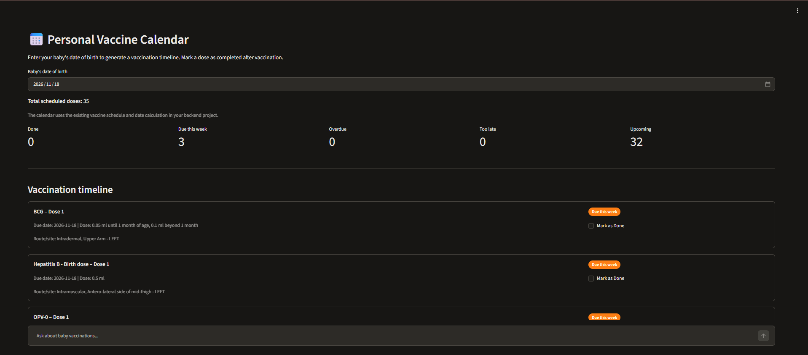

# TeekaTimer: Baby Vaccine Due-Date Helper

**Product:** TeekaTimer. Enter your baby's date of birth and see which government vaccines are due, with answers from official MoHFW immunization handbooks.

**User:** A young mother in a village near Kopargaon whose 6-week-old son missed the 6-week anganwadi session and who is worried whether it is too late.

**Problem:** Parents often don't know which vaccine is due when, or whether a missed dose can still be given.

**Data source:** MoHFW National Immunization Schedule and the Immunization Handbook for Medical Officers ([mohfw.gov.in](https://mohfw.gov.in), [nhm.gov.in](https://nhm.gov.in)).

## Data source

MoHFW National Immunization Schedule (Unit 2) and the Immunization Handbook for Medical Officers, from mohfw.gov.in and nhm.gov.in.

## How to run

Create and activate a virtual environment:

```bash
python -m venv .venv
```

On Windows PowerShell:

```powershell
.venv\Scripts\Activate.ps1
```

Install dependencies:

```bash
python -m pip install -r requirements.txt
```

Fetch and process the source data:

```bash
python -m app.fetch
python -m app.ingest
```

Run the CLI:

```bash
python -m app.cli
```

Run the analysis:

```bash
python -m analysis.explore
```

Start the FastAPI backend:

```bash
python -m uvicorn app.main:app --reload
```

Open the API documentation:

[http://127.0.0.1:8000/docs](http://127.0.0.1:8000/docs)

## Endpoints

- `GET /health`
- `GET /records?limit=`
- `GET /records/{id}`
- `GET /search?q=`
- `POST /questions`

## Docs and evaluation

- `docs/how_llms_work.md` explains how LLMs work in my own words.
- `eval/questions.md` has 10 test questions, and Q6 cannot be answered from the data.
- `python -m eval.check_questions` checks them against the search.
- Known issues: with `/chat`, Q10 still gets an unknown answer because the records say pregnancy and the question says pregnant women, and Fractional IPV is missing from the 6-week answers. Semantic search (Day 7) should help with both.

## LLM chat (Day 6)

- `app/llm.py` calls Groq. The API key is read from `.env`, which is not committed. Copy `.env.example` to `.env` and add your key.
- `POST /chat` returns answer, confidence, follow_up and sources, using the top records from the TF-IDF search.
- `prompts/` has the system prompt and two task prompts (v1 and v2).
- `python -m eval.prompt_compare` runs both prompt versions on the test questions and writes `eval/prompt_compare.md`.

## Semantic search (Day 7)

- `app/chunking.py` splits the PDFs and HTML in `data/raw` into overlapping chunks, keeping source, page and title.
- `app/embed.py` makes embeddings and `app/vectorstore.py` stores them in a persistent Chroma collection (`data/chroma`, not committed).
- Build the index with:

```bash
python -m app.vectorstore
```

- `GET /search/semantic?q=` returns the closest chunks.
- `eval/search_results.md` has the top hits for the 10 test questions.
- Chroma runs in GitHub Codespaces, because it is blocked by Application Control on my laptop.

## RAG Question Answering (Day 8)

- Integrated retrieval-augmented generation using the existing ChromaDB vector database.
- Retrieves relevant MoHFW document chunks and generates answers using the LLM.
- Displays source citations with document names and page numbers.
- Uses a fallback response when the answer is not supported by the available documents.
- Evaluation results are maintained in the `eval` directory.

## Agent Workflow (Day 9)

- Added a custom agent loop that selects between document search and vaccine calendar calculation tools.
- Integrated LangGraph to manage agent workflow and conversation state.
- Added a human approval step before executing the selected tool.
- Implemented the `POST /agent` endpoint with thread-based workflow resumption.

## TeekaTimer Streamlit UI (Day 10)

TeekaTimer provides a user interface for asking vaccination questions and tracking a baby's vaccination schedule.

### Features

- RAG assistant using the `POST /ask` endpoint.
- Agent assistant using the `POST /agent` endpoint with human approval.
- Displays answers with source citations.
- Saves thumbs-up and thumbs-down feedback in a local SQLite database.
- Generates a personal vaccination timeline using the baby's date of birth.
- Displays vaccine statuses: Done, Due this week, Overdue, Too late and Upcoming.
- Allows users to mark doses as completed and undo completion.
- Exports the vaccination schedule as a downloadable text checklist.

### Screenshots

**Vaccination Assistant**


**Personal Vaccine Calendar**



### Run the application

Install dependencies:

```bash
python -m pip install -r requirements.txt
```

Start the FastAPI backend in the first terminal:

```bash
python -m uvicorn app.main:app --host 0.0.0.0 --port 8000
```

Start the Streamlit interface in a second terminal:

```bash
python -m streamlit run ui/app.py --server.address 0.0.0.0 --server.port 8502
```

Open the forwarded Streamlit port `8502` in your browser.

### Local storage

- SQLite stores user feedback and completed vaccine-dose records.
- The SQLite database is stored locally at `data/teekatimer_ui.db` and is excluded from Git.
- ChromaDB continues to store the document embeddings used by the RAG system.

**Disclaimer:** TeekaTimer is an educational vaccination tracking assistant, not a medical prescription. Always confirm vaccination schedules and decisions with a qualified healthcare professional.
