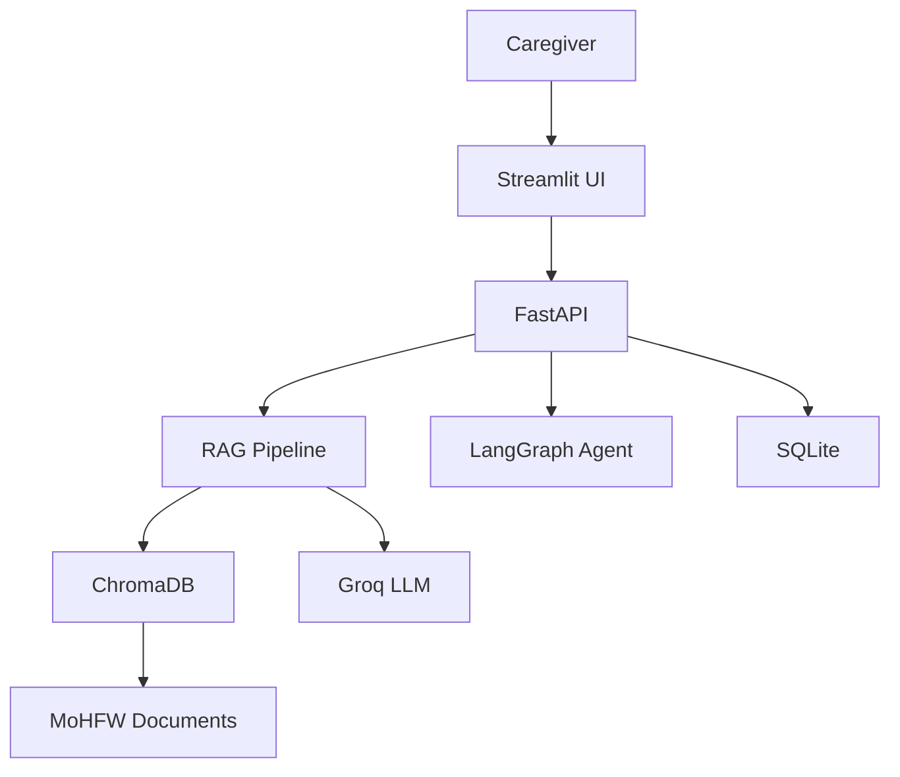
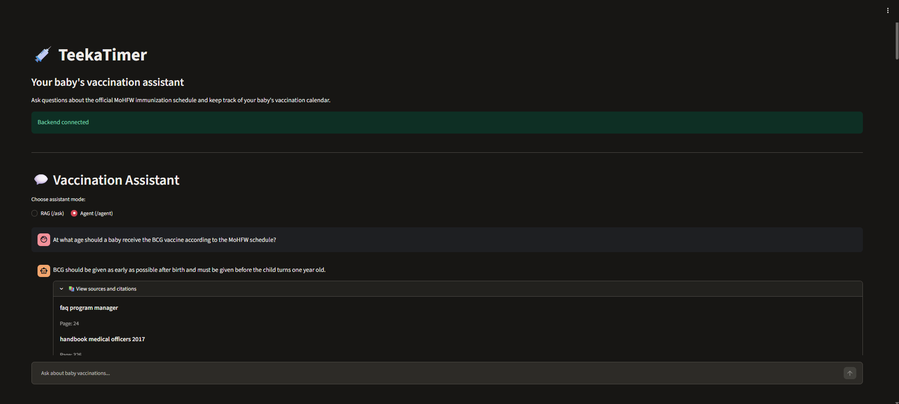

# TeekaTimer: Baby Vaccine Due-Date Helper

[](https://github.com/Sai0045/Gen-AI-Examate-Training/actions/workflows/ci.yml)

**Product:** TeekaTimer helps parents and caregivers track government-recommended childhood vaccines. Enter a baby's date of birth to see which vaccines are due and ask vaccination-related questions using official MoHFW immunization documents.

**Target users:** Parents and caregivers who need clear information about routine childhood vaccinations and missed doses.

**Problem:** Parents may not know when a vaccine is due or what to do when a vaccination is missed.

**Data sources:** MoHFW National Immunization Schedule and the Immunization Handbook for Medical Officers, available from [MoHFW](https://mohfw.gov.in/) and [NHM](https://nhm.gov.in/).

## Project Overview

TeekaTimer helps parents and caregivers understand childhood vaccination schedules, track due dates and find reliable answers using official MoHFW documents.

### Key Features
- RAG-based vaccination question answering with source and page citations.
- ChromaDB semantic search over official documents.
- LangGraph agent with human approval.
- DOB-based vaccine calendar and dose tracking.
- SQLite feedback storage and checklist export.
- Input validation, LLM response caching and usage logging.

### Architecture



### Verified Results

| Metric | Result |
|---|---:|
| Document chunks indexed | 885 |
| Vaccine records | 21 |
| Automated tests passing | 19 |
| Ruff checks | Passed |
| Deployment | Render UI and API verified |

### Live Demo
- [Streamlit Application](https://teekatimer-ui.onrender.com)
- [FastAPI Documentation](https://teekatimer-api.onrender.com/docs)
- Demo video: Coming soon.

## Production Notes (Day 13)

### Performance and Usage Logging
- Logs per-request latency in milliseconds.
- Captures Groq input, output and total token usage when returned by the API.
- Cache hits are logged separately and do not make an LLM API call.

### Response Cache
- In-memory cache with a 300-second TTL and a maximum of 128 entries.
- Cache test: 3 requests (2 identical and 1 different) resulted in 2 mocked API calls and 1 cache hit.
- This test demonstrates one fewer API call in that test scenario; it is not a production-wide savings benchmark.

### Input Validation
- Question input is limited to 2,000 characters across four POST and two GET endpoints.
- Oversized inputs are rejected with HTTP 422.

### Security and Quality Checks
- Added a prompt-injection test using a malicious retrieved passage and a mocked LLM response.
- Automated tests: 19 passed.
- Ruff checks: passed.
- Live latency and token averages have not yet been benchmarked.

## Data Sources

TeekaTimer uses official government immunization documents, including:

- MoHFW National Immunization Schedule (Unit 2).
- Immunization Handbook for Medical Officers.
- Supporting vaccination FAQ documents included in the project data.

## How to Run

### 1. Create a virtual environment

```bash
python -m venv .venv
```

On Windows PowerShell, activate it using:

```powershell
.venv\Scripts\Activate.ps1
```

### 2. Install dependencies

```bash
python -m pip install -r requirements.txt
```

### 3. Fetch and process source data

```bash
python -m app.fetch
python -m app.ingest
```

### 4. Run the CLI

```bash
python -m app.cli
```

### 5. Run the data analysis

```bash
python -m analysis.explore
```

### 6. Start the FastAPI backend

```bash
python -m uvicorn app.main:app --reload
```

Open the API documentation:

[http://127.0.0.1:8000/docs](http://127.0.0.1:8000/docs)

## API Endpoints

| Method | Endpoint | Description |
|---|---|---|
| GET | `/health` | Checks API health and vaccine record count. |
| GET | `/records?limit=` | Retrieves vaccine records. |
| GET | `/records/{id}` | Retrieves a specific vaccine record. |
| GET | `/search?q=` | Searches vaccine records. |
| POST | `/questions` | Handles vaccination-related questions. |
| POST | `/chat` | Provides vaccine schedule chat using the LLM. |
| GET | `/search/semantic?q=&k=` | Performs semantic search over MoHFW documents. |
| POST | `/ask` | Provides RAG-based answers with citations. |
| POST | `/agent` | Runs the LangGraph agent workflow. |

## Documentation and Evaluation

- `docs/how_llms_work.md` explains how large language models work in my own words.
- `eval/questions.md` contains 10 test questions, including an out-of-scope question that should not be answered from the available data.
- `python -m eval.check_questions` evaluates questions against the search system.
- Evaluation reports and results are maintained in the `eval/` directory.

## LLM Chat (Day 6)

- Integrated Groq to generate answers using a large language model.
- `app/llm.py` handles LLM calls.
- The Groq API key is stored in `.env` and is not committed to Git.
- `.env.example` provides the environment variable template.
- `POST /chat` returns an answer, confidence, follow-up information and sources using TF-IDF search results.
- `prompts/` contains the system prompt and two task prompt versions.
- `python -m eval.prompt_compare` compares both prompt versions and generates `eval/prompt_compare.md`.

## Semantic Search (Day 7)

- `app/chunking.py` splits PDF and HTML documents in `data/raw/` into overlapping text chunks.
- Each chunk retains its source document, page number and title.
- `app/embed.py` generates text embeddings using ChromaDB's default embedding function.
- `app/vectorstore.py` stores document embeddings and metadata in a persistent ChromaDB collection.
- The local ChromaDB index is stored in `data/chroma/` and excluded from Git.

Build the semantic search index locally:

```bash
python -m app.vectorstore
```

- `GET /search/semantic?q=` retrieves the most relevant document chunks.
- `eval/search_results.md` contains semantic search results for the evaluation questions.
- ChromaDB was developed and tested in GitHub Codespaces because of Application Control restrictions on my laptop.

## RAG Question Answering (Day 8)

Implemented Retrieval-Augmented Generation (RAG) to answer questions using official MoHFW documents.

Features:

- Retrieves relevant document chunks from ChromaDB.
- Uses retrieved context to generate answers through the LLM.
- Includes source document names and page numbers in citations.
- Uses a fallback response when the available documents do not support an answer.
- Validates generated citations against retrieved sources.
- Maintains evaluation questions and results in the `eval/` directory.

## Agent Workflow (Day 9)

Implemented an agent workflow using LangGraph.

Features:

- Uses a custom agent workflow to select between document search and vaccine calendar calculation tools.
- Uses LangGraph to manage workflow state and conversation flow.
- Includes a human approval step before executing the selected tool.
- Supports workflow resumption using thread-based state.
- Exposes the workflow through the `POST /agent` endpoint.

## TeekaTimer Streamlit UI (Day 10)

TeekaTimer provides a Streamlit interface for asking vaccination questions and tracking a baby's vaccination schedule.

### Features

- RAG assistant connected to the `POST /ask` endpoint.
- Agent assistant connected to the `POST /agent` endpoint with human approval.
- Displays answers with source citations.
- Saves thumbs-up and thumbs-down feedback in a local SQLite database.
- Generates a personal vaccination timeline using the baby's date of birth.
- Displays vaccine statuses: Done, Due this week, Overdue, Too late and Upcoming.
- Allows users to mark doses as completed and undo completion.
- Exports the vaccination schedule as a downloadable text checklist.

### Screenshots

**Vaccination Assistant**



**Personal Vaccine Calendar**


### Run the Application

Install dependencies:

```bash
python -m pip install -r requirements.txt
```

Start the FastAPI backend in the first terminal:

```bash
python -m uvicorn app.main:app --host 0.0.0.0 --port 8000
```

Start the Streamlit interface in a second terminal:

```bash
python -m streamlit run ui/app.py --server.address 0.0.0.0 --server.port 8502
```

Open the forwarded Streamlit port `8502` in your browser.

### Local Storage

- SQLite stores user feedback and completed vaccine-dose records.
- The SQLite database is stored at `data/teekatimer_ui.db` and excluded from Git.
- ChromaDB stores document embeddings used by the RAG system.

**Disclaimer:** TeekaTimer is an educational vaccination tracking assistant, not a medical prescription. Always confirm vaccination schedules and decisions with a qualified healthcare professional.

## CI and Deployment (Day 12)

### Continuous Integration

GitHub Actions runs the CI workflow on every push and pull request to the `main` branch.

The workflow:

- Sets up Python 3.14.
- Installs project dependencies.
- Runs Ruff to check code quality.
- Runs the pytest test suite.
- Builds the Docker image to verify the application image.

The workflow is defined in `.github/workflows/ci.yml`.

The CI status is displayed using the badge at the top of this README.

### Docker Image Optimization

Previously, the application built the ChromaDB index during API startup. This involved downloading the embedding model and processing documents when the Render instance started.

To avoid repeated indexing during application startup, the indexing process was moved into the Docker image build.

The Dockerfile runs:

```dockerfile
RUN python -m app.vectorstore
```

This creates the ChromaDB index while building the Docker image.

Benefits:

- The RAG index is prepared before the API starts.
- The API does not need to run a background indexing process at startup.
- The deployed image includes the prebuilt ChromaDB index.
- Reduces runtime indexing work during API startup.

The deployed image successfully created an index containing **885 document chunks**.

### Deployment Status

Both services are deployed on Render.

| Component | Status |
|---|---|
| Streamlit UI | Deployed and verified |
| FastAPI backend | Deployed and verified |
| Docker image build | Successful |
| RAG index creation | 885 chunks indexed |
| API health check | Verified |
| Semantic search | Verified |
| RAG question answering | Verified |
| Source citations | Verified |
| Out-of-scope question handling | Verified |

### Live Application

- **Streamlit UI:** https://teekatimer-ui.onrender.com
- **FastAPI API:** https://teekatimer-api.onrender.com
- **API Documentation:** https://teekatimer-api.onrender.com/docs
- **API Health Check:** https://teekatimer-api.onrender.com/health

### Deployment Verification

The following checks were performed on the deployed application:

1. Verified the FastAPI health endpoint.
2. Verified semantic search using an immunization-related question.
3. Tested the `POST /ask` endpoint through Swagger UI.
4. Verified that the RAG response included source document names and page citations.
5. Opened the deployed Streamlit application and verified its API connection.
6. Tested a BCG vaccination question through the Streamlit RAG interface.
7. Tested an unrelated FIFA World Cup question and verified that the system abstained instead of generating an unsupported answer.

## Run with Docker Compose

Make sure Docker and Docker Compose are installed.

### 1. Create the environment file

```bash
cp .env.example .env
```

Add your Groq API key and other required environment variables to `.env`.

**Important:** Never commit `.env` or expose API keys in your GitHub repository.

### 2. Build and start the services

```bash
docker compose up --build -d
```

### 3. Access the application

- Streamlit UI: port `8502`
- FastAPI backend: port `8000`
- API documentation: port `8000/docs`

### 4. Check running containers

```bash
docker compose ps
```

### 5. View application logs

```bash
docker compose logs -f
```

### 6. Stop the containers

```bash
docker compose down
```

Docker Compose uses the project configuration to start the application services. The `.env` file is supplied through the Compose configuration and is not copied into the Docker image.

---

## Project Repository

**GitHub:** https://github.com/Sai0045/Gen-AI-Examate-Training

**Project:** TeekaTimer – Baby Vaccine Due-Date Helper

### Technologies Used

- Python
- FastAPI
- Streamlit
- Groq LLM
- Retrieval-Augmented Generation (RAG)
- ChromaDB
- LangGraph
- SQLite
- Docker
- GitHub Actions
- Render

**Disclaimer:** This project is intended for educational and informational purposes. It does not replace professional medical advice. Always consult a qualified healthcare professional for vaccination decisions.