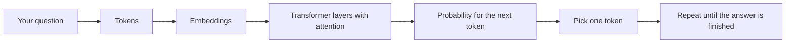

# How LLMs Work

## What an LLM is
A large language model (LLM) is a program trained on a huge amount of text. It learns the patterns of language, so when it gets some text it can continue it in a sensible way. It does not look facts up like a search engine. It predicts text.

## Tokens
The model cannot read words directly. The text is first cut into small pieces called tokens. A token can be a whole word, part of a word or a symbol, so a long word like "vaccination" may become two or three tokens.

## Embeddings
Each token is changed into a list of numbers called an embedding. Tokens with similar meanings get similar numbers, so the model can work with meaning using maths.

## Attention and the transformer
The transformer is the main design of modern LLMs. Attention lets every token look at the other tokens in the text and decide which ones matter most for it. For example, in "the baby missed the dose, so it is due again", attention helps the model connect "it" with "dose".

## Predicting the next token
The model gives a probability to every possible next token and picks one. It adds that token to the text and repeats the process. An answer is built one token at a time.

## Why it can be wrong
The model predicts likely text, not true text, so it can say wrong things in a confident way. This is called hallucination. For TeekaTimer this is a real danger, because wrong vaccine advice can harm a baby.

## What this means for TeekaTimer
TeekaTimer must answer only from the official MoHFW records it finds with its search, and it must say "I don't know" when nothing matches. Today the search is TF-IDF. In the next days an LLM will write the final answer, but only from the retrieved MoHFW records.
